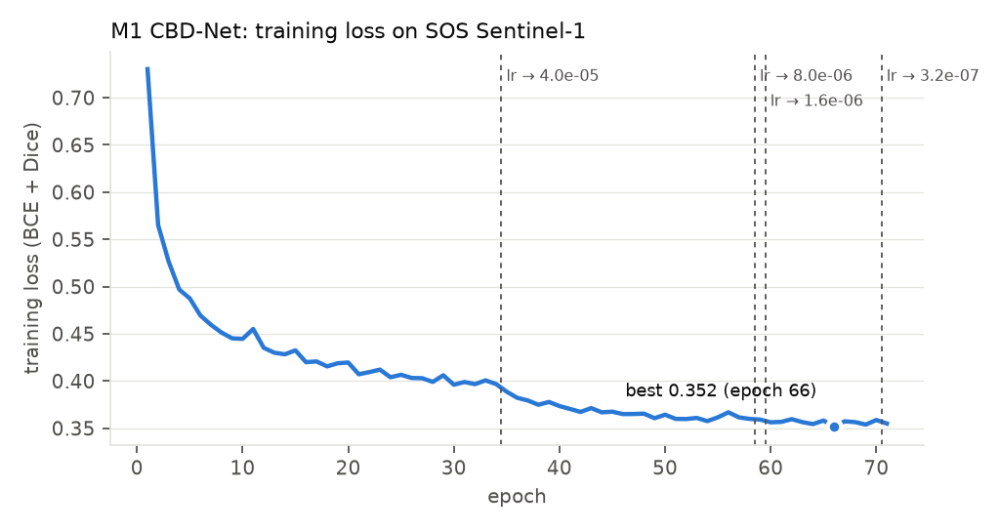
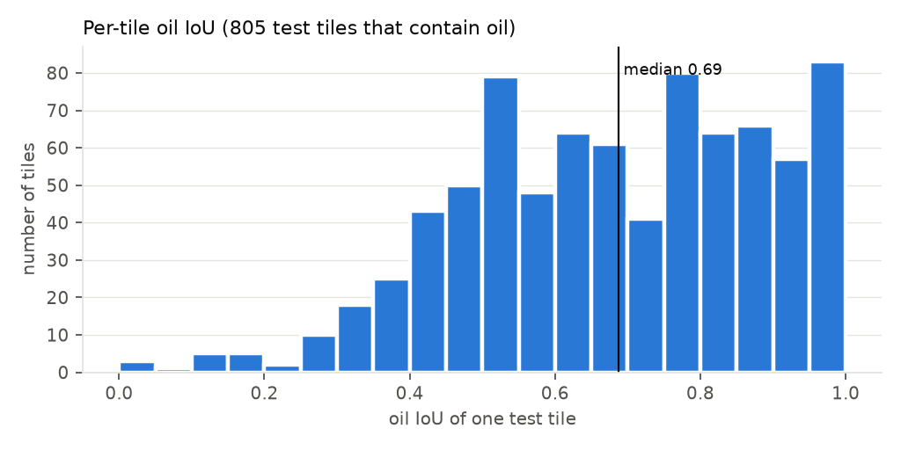
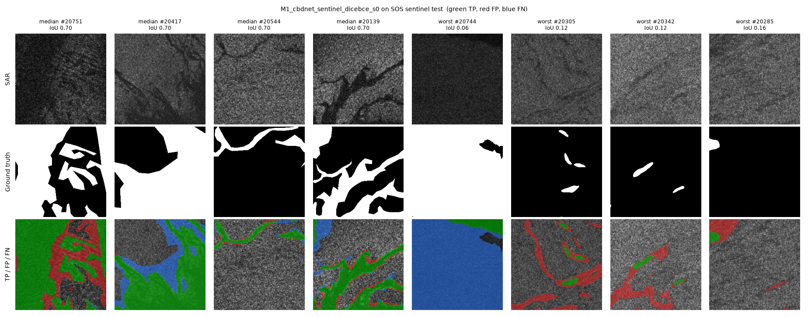
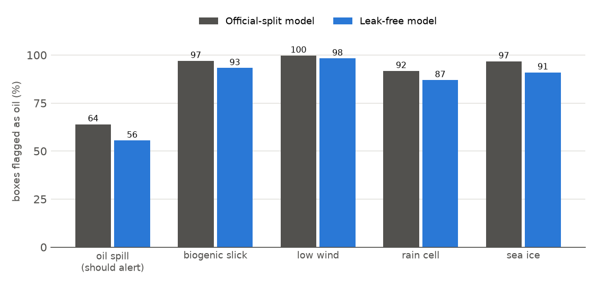

# M1: CBD-Net (Contextual and Boundary-supervised Detection Network)

**Paper:** Q. Zhu *et al.*, "Oil spill contextual and boundary-supervised detection network based on marine SAR images," *IEEE TGRS*, 2022 [P24].
**Code:** the official repository, [github.com/CUG-URS/CBDNet-main](https://github.com/CUG-URS/CBDNet-main), copied unchanged into `third_party/CBDNet-main/`.
**Role in this project:** the first of three published methods we re-implement (M1–M3). It is also the baseline from the authors of the SOS dataset.

## Results at a glance (SOS Sentinel-1, official split, 839 test tiles)

| | **Ours** | Published [P29] | Gap |
|---|---|---|---|
| **mIoU** | **82.79 %** | 82.94 % | −0.15 pp |
| **F1 (oil)** | **87.91 %** | 87.81 % | +0.10 pp |
| Accuracy | 91.24 % | — | |
| Precision / recall (oil) | 84.43 % / 91.69 % | — | |

**Verdict:** the reproduction succeeds. Both gaps are well within the ±2 pp target.
The full table, probability-quality metrics and figures are in [`results/sentinel_official_split/results.md`](results/sentinel_official_split/results.md).

| Training curve | Per-tile IoU | Qualitative |
|---|---|---|
|  |  |  |

## Second run: leak-free (group-disjoint) split, for C1

The official SOS test set contains augmented copies of training sea areas. We retrained the **identical setup** on a split where no sea area appears in both train and test: 3,358 train tiles, about the official 3,354, and 835 test tiles.

| Metric (with TTA) | Official split (leaky) | **Group-disjoint** | Difference |
|---|---|---|---|
| **Oil IoU** | 78.43 % | **76.68 %** | −1.74 pp |
| **Oil F1** | 87.91 % | **86.80 %** | −1.11 pp |
| Recall (oil) | 91.69 % | 87.01 % | −4.67 pp |
| Precision (oil) | 84.43 % | 86.59 % | +2.16 pp |
| mIoU | 82.79 % | 83.06 % | +0.27 pp |

**Finding:** the leakage inflates the oil metrics only slightly (about 1–2 pp). On unseen areas the model misses a little more oil.
mIoU does not show this, because the new test set has less oil (29.6 % vs 34.7 % of pixels), which raises background IoU.
This is one seed and an area-level (not scene-level) split, so it is preliminary.
Details: [`results/sentinel_group_split/results.md`](results/sentinel_group_split/results.md).

**Qualitative, group split:** the worst tiles are (a) a large dark patch predicted as oil where only a thin strip is labelled, a possible low-wind look-alike; (b) faint thin slicks that are missed; and (c) a tile labelled almost entirely as oil with no visible slick edge, which is label ambiguity.

## External test: Peru (new sea, never used for training)

Both M1 models, frozen, on all 2,013 Peru patches (40 scenes):

| Metric | SOS test | **Peru** (official model) | **Peru** (leak-free model) |
|---|---|---|---|
| **Oil F1** | 87.9 % | **24.5 %** | **29.4 %** |
| **Oil IoU** | 78.4 % | **13.9 %** | **17.3 %** |
| Recall / precision (oil) | 91.7 / 84.4 % | 96.8 / **14.0 %** | 95.3 / **17.4 %** |
| Look-alike pixels called oil | (no class in SOS) | **89.9 %** | **86.0 %** |
| ROC-AUC | 0.975 | 0.921 | 0.926 |
| ECE | 0.028 | **0.265** | **0.186** |

**Finding:** M1 transfers badly to a new sea. It still finds about 96 % of the oil, but it calls almost every dark area oil (look-alikes, ships, about a third of open sea), so about 6 of every 7 alarms are false. The ranking stays good (AUC 0.92), but the 0.5 threshold and the probabilities become wrong (ECE ×7–9). This is the problem that C2 (calibration) and C3 (alert threshold) target.
Details and figures: [`results/peru_external/results.md`](results/peru_external/results.md).

## External test: MDOD (look-alike false alerts, box labels)

Both M1 models, frozen, on 400 boxes per class from MDOD. MDOD has boxes, not pixel masks, so we measure how often a box is flagged as oil (at least 2 % of its pixels at p > 0.5):

| Box class | Official model | Leak-free model |
|---|---|---|
| **Oil spill** (should alert) | **64 %** | **56 %** |
| Biogenic slick | 97 % | 93 % |
| Low wind | 100 % | 98 % |
| Rain cell | 92 % | 87 % |
| Sea ice | 97 % | 91 % |
| AUC, oil vs all look-alikes (0.5 = coin flip) | **0.28** | **0.34** |



**Finding:** every look-alike type triggers *more* alerts than real oil, and the AUC is below 0.5, so M1 ranks look-alikes above oil. It has learned "dark area = oil". Caveat: MDOD is about 10× coarser than SOS, so thin oil streaks are easy to miss. The look-alike false alerts are the evidence for C4.
Details: [`results/mdod_external/results.md`](results/mdod_external/results.md).

## Code map: where each part of M1 lives

The `M1_CBDNet/` folder holds only what is specific to M1. The network is the authors' code, kept untouched in `third_party/`, so the method is exactly theirs. Data loading and evaluation live in `common/`, so M1, M2 and M3 are all tested the same way.

| Part of M1 | File | Written by |
|---|---|---|
| **Model** (CBD-Net network) | [`third_party/CBDNet-main/networks/CBDNet.py`](../third_party/CBDNet-main/networks/CBDNet.py) | Official authors, unchanged |
| **Loss** (BCE + Dice) | [`third_party/CBDNet-main/dice_bce_loss.py`](../third_party/CBDNet-main/dice_bce_loss.py) | Official authors, unchanged |
| Paper's boundary loss (optional, `--loss joint`) | [`third_party/CBDNet-main/boundary_bce_loss2.py`](../third_party/CBDNet-main/boundary_bce_loss2.py) | Official authors, unchanged |
| **Training loop** | [`train_m1.py`](train_m1.py) | Us, following the official `train.py` |
| **Data loading and augmentation** | [`common/sos_data.py`](../common/sos_data.py) | Us; augmentation copied from the official `data.py` |
| **Testing and metrics on SOS** | [`common/evaluate.py`](../common/evaluate.py) | Us; shared by M1–M3 |
| **Testing on Peru** (external) | [`common/evaluate_peru.py`](../common/evaluate_peru.py) | Us; shared by M1–M3 |
| **Testing on MDOD** (external, boxes) | [`common/evaluate_mdod.py`](../common/evaluate_mdod.py) | Us; shared by M1–M3 |
| Model registry (choose M1 / M2 / M3 by name) | [`common/models.py`](../common/models.py) | Us |
| **Report and figures** | [`make_report.py`](make_report.py) | Us |
| **One-command run** | [`run_m1.ps1`](run_m1.ps1) | Us |

```
train_m1.py ──uses──► CBDNet.py (official model) + dice_bce_loss.py (official loss) + sos_data.py (data)
     │ saves runs/<run>/best.pth
     ▼
evaluate.py / evaluate_peru.py / evaluate_mdod.py ──► metrics.json, probability maps, qualitative figure
     ▼
make_report.py ──► results/<split>/results.md + figures
```

## How the method works

```
SAR tile 256×256 ─► ResNet-34 encoder (ImageNet) with scSE attention after every stage
                    │  (scSE = re-weights channels and pixel locations)
                    ▼
                    Dilated-convolution block (rates 1, 2, 4, 8): wide context at the bottleneck
                    ▼
                    LinkNet decoder (4 upsampling blocks + additive skip connections)
                    ▼
                    Sigmoid ─► oil probability per pixel ─► threshold 0.5 ─► oil mask
```

## Setup we used (same as the official code)

| Setting | Value |
|---|---|
| Training data | SOS Sentinel-1 training set: 3,354 tiles of 256 × 256 |
| Loss | BCE + Dice (as in the released code) |
| Optimiser | Adam, learning rate 2 × 10⁻⁴, batch 4 |
| Schedule | Up to 80 epochs. After more than 3 epochs without improvement, reload the best weights and divide the learning rate by 5; stop after more than 6. Ours stopped at epoch 71. |
| Augmentation | HSV jitter, shift-scale, horizontal and vertical flips, 90° rotations (official) |
| Testing | Official 8-way test-time augmentation (4 rotations × flip, averaged) |
| Hardware | RTX 3050 laptop GPU (4 GB), 1 h 47 min |

**What we changed, and why:**
1. `np.math` → `math`: needed for NumPy 2. The behaviour is identical.
2. `shuffle=True`: the official code uses `shuffle=False`. Shuffling is standard practice.
3. Fixed random seeds and a per-epoch CSV log, so runs can be repeated.

The network, the loss and the schedule are imported **unchanged** from the official code.

## Two things we found in the official code
1. **The official evaluation script (`t1p3-Iou.py`) reports precision, recall and F1 for the *background* class, not for oil.** Its `confusion_matrix(labels=[255, 0])` makes index 1 the background. Our evaluator reports oil-class metrics as the main numbers, and the official-script value (93.14 %) separately for comparison.
2. **The released code trains with BCE + Dice only.** The paper also describes a boundary loss, which the repository implements as `jointloss` but does not use by default. It can be run with `--loss joint`.

## Observations (qualitative)
- Large slicks are segmented well. Most errors sit on slick edges, where the ground-truth outlines are coarse polygons. This explains the low boundary F1 (37.8 %).
- The worst tiles are (a) fully dark tiles labelled as oil, where the tile shows no edge or context, and (b) thin dark streaks that the model marks as oil but the labels do not. These are possible look-alikes or missing labels.
- Probabilities are already fairly well calibrated in-domain (ECE 0.028).

**Caveat:** the official SOS test set contains augmented copies of training areas (see `../leakage_check/REPORT.md`). These scores show that the **reproduction is correct**. They are not a measure of generalisation to new seas.

## Files

| File | What it is |
|---|---|
| `train_m1.py` | Training script (official network, loss and schedule) |
| `run_m1.ps1` | One command: train → evaluate → build the report |
| `make_report.py` | Builds `results/` (tables and figures) from a finished run |
| `results/sentinel_official_split/` | **Presentable results, run 1** (official split): `results.md`, the figures, `metrics.json`, `per_tile.csv`, `train_log.csv` |
| `results/peru_external/` | **Peru external test** for both models: `results.md`, qualitative figures, metrics |
| `make_peru_report.py` | Builds `results/peru_external/` |
| `results/mdod_external/` | **MDOD external test** for both models: `results.md`, alert-rate chart, qualitative figures, metrics |
| `make_mdod_report.py` | Builds `results/mdod_external/` |
| `report/M1_CBDNet_Results_Report.docx` / `.pdf` | **Full M1 report** (all tests, tables, figures, console outputs). Rebuild: `report/make_terminal_pics.py` → `report/build_m1_report.py` → `report/to_pdf.ps1` |
| `results/sentinel_group_split/` | **Presentable results, run 2** (leak-free split, C1): same files, plus the comparison with run 1 |
| `logs/` | Full console log of the run |
| `../runs/M1_cbdnet_sentinel_dicebce_s0/` | Heavy outputs, run 1: weights `best.pth` (126 MB), probability maps `probs_sentinel.npz`, predicted masks |
| `../runs/M1_cbdnet_sentinel_dicebce_s0_groupsplit/` | Heavy outputs, run 2 (same files, suffix `_groupsplit`) |

**Reproduce** (from `experiments/`):
```powershell
powershell -ExecutionPolicy Bypass -File M1_CBDNet\run_m1.ps1
```
**Run 2 (group split):**
```powershell
$S = "leakage_check\splits\sos_sentinel_group_s0.csv"
.venv\Scripts\python M1_CBDNet\train_m1.py --split $S
.venv\Scripts\python common\evaluate.py --run runs\M1_cbdnet_sentinel_dicebce_s0_groupsplit --split $S
.venv\Scripts\python M1_CBDNet\make_report.py --run runs\M1_cbdnet_sentinel_dicebce_s0_groupsplit --split groupsplit --tag sentinel_group_split
```
**Evaluate only** (uses the saved weights):
```powershell
.venv\Scripts\python common\evaluate.py --run runs\M1_cbdnet_sentinel_dicebce_s0 --sensor sentinel
.venv\Scripts\python M1_CBDNet\make_report.py
```

## Run from an editor (Antigravity / VS Code)

1. Open the repository folder. `.vscode/settings.json` selects the project Python (`.venv\Scripts\python.exe`).
2. Open `M1_CBDNet/run_m1.py`, set `STEP` (`check`, `train`, `eval_sos`, `eval_peru`, `eval_mdod`, `report`, `all_tests`) and `SPLIT` (`leaky` or `leakfree`) at the top, and press Run.
3. `check` (the default) only lists what exists and prints the commands. Training refuses to replace an existing model unless `OVERWRITE = True`.
